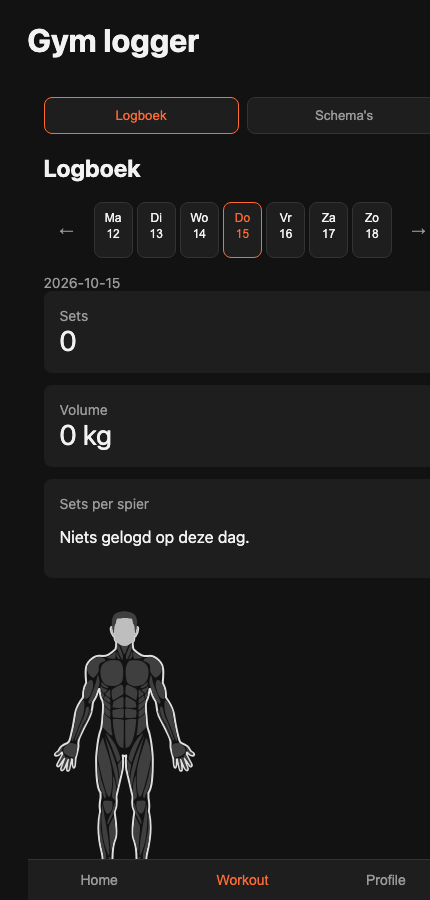

# Gym Logger

A minimal, mobile-first gym workout logger built with React and Redux Toolkit.



> **Note:** the UI is currently in Dutch.

## How it works

Gym Logger organizes your training in four levels:

```
Schedule            e.g. "PPL"
└── Workout         e.g. "Push"
    └── Exercise    e.g. "Barbell Bench Press"
        └── Details tap an exercise to see its details
```

1. **Schedules**: your training plan, for example a Push/Pull/Legs (PPL) split.
2. **Workouts**: the sessions inside a schedule, for example *Push*.
3. **Exercises**: the exercises in a workout, picked from a searchable catalog. For each exercise you log sets of weight (kg) and reps.
4. **Exercise details**: tap an exercise to see its details: images, target muscles, equipment and step-by-step instructions.

## Features

- **Detailed logging**: log weight (kg) and reps for every set. A 90-second rest timer starts after each set, and a "saved" message confirms when you finish a workout.
- **See what you've trained**: the logbook shows each day's workouts and exercises, total sets, total volume (kg) and sets per muscle.
- **Body map**: a body map highlights the muscles you trained on the selected day.
- **Weekly overview**: browse your logbook week by week with a day-by-day week strip. The Home tab shows how many sessions you did this week and your current training streak in days.
- **PR tracking**: after a workout, the Home tab shows new personal records, meaning any exercise where you lifted a heavier weight than in your earlier sessions.
- **Exercise catalog**: search exercises from the open [free-exercise-db](https://github.com/yuhonas/free-exercise-db).
- **Profile**: store your weight, height and gender, and see your calculated BMI.

## Stack

- [React 19](https://react.dev/) + [TypeScript](https://www.typescriptlang.org/)
- [Vite](https://vite.dev/)
- [Redux Toolkit](https://redux-toolkit.js.org/) + React Redux
- [Sass (SCSS)](https://sass-lang.com/)
- [react-muscle-highlighter](https://www.npmjs.com/package/react-muscle-highlighter) for the body map
- [Oxlint](https://oxc.rs/) for linting

## Getting started

Requires Node.js 20+.

```bash
npm install
npm run dev      # start the dev server
npm run build    # type-check and build for production
npm run preview  # preview the production build
```

## Privacy

All your data (schedules, logged sets, profile) is stored only in your browser's `localStorage`. There is no backend and no account, and nothing is sent anywhere. The only network requests load the public exercise list and its images.

## Exercise data

Exercise data comes from [yuhonas/free-exercise-db](https://github.com/yuhonas/free-exercise-db), loaded from
`https://raw.githubusercontent.com/yuhonas/free-exercise-db/main/dist/exercises.json`. Many thanks to its maintainers.

## Contributing

Issues and pull requests are welcome. Please keep changes small and focused, and make sure `npm run build` and `npm run lint` pass.

## License

[MIT](LICENSE) © 2026 Berke Yücedag
